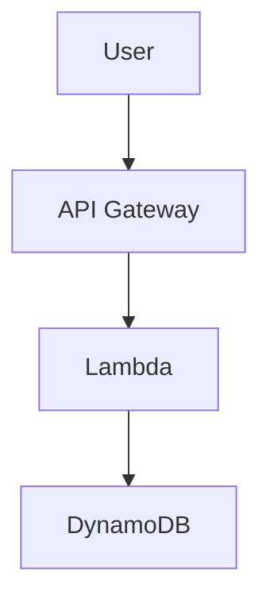

# mdshare

**Turn any markdown into a shareable link — instantly.**

[](https://vercel.com/new/clone?repository-url=https%3A%2F%2Fgithub.com%2FRileyLin%2Fmdshare)
[](LICENSE)

---

## The Problem

You write a great response in Claude, ChatGPT, or your terminal — full of headers, code blocks, and bullet lists — and then you paste it into Slack or iMessage and it looks like garbage. Raw markdown everywhere.

**mdshare fixes this.** POST your markdown, get a clean rendered URL back. Share that URL anywhere.

---

## Quick Start

```bash
curl -X POST https://mdshare-rileylins-projects.vercel.app/api/share \
  -H "Content-Type: application/json" \
  -d '{"markdown": "# Hello\n\nThis is **rendered** markdown with `code` and everything."}'
```

**Response:**
```json
{
  "url": "https://mdshare-rileylins-projects.vercel.app/v/abc123",
  "id": "abc123",
  "expires_in": 86400
}
```

Open the URL in any browser and you get a beautiful GitHub-styled page. Share it in Slack, iMessage, email — it just works.

---

## MCP Server (for Claude Desktop & AI Assistants)

The `mdshare-mcp` package lets Claude (and any MCP-compatible AI) share markdown directly from a conversation.

### Install

```bash
npm install -g mdshare-mcp
```

### Configure Claude Desktop

Add this to your `claude_desktop_config.json`:

```json
{
  "mcpServers": {
    "mdshare": {
      "command": "mdshare-mcp"
    }
  }
}
```

Config file locations:
- **macOS:** `~/Library/Application Support/Claude/claude_desktop_config.json`
- **Windows:** `%APPDATA%\Claude\claude_desktop_config.json`
- **Linux:** `~/.config/Claude/claude_desktop_config.json`

Restart Claude Desktop. You'll see `share_markdown` available in the tools panel.

### What Claude can do with it

> "Share this analysis as a link I can send to my team"

Claude will call `share_markdown` with the content and return a URL you can paste anywhere.

> "Draw the system architecture as a diagram"

Claude includes a ` ```mermaid ` block in the markdown — it renders as an interactive SVG on the page.

> "Share this custom SVG chart"

Claude calls `share_diagram` with raw SVG markup for fully custom visuals.

### MCP Tools

| Tool | Description |
|------|-------------|
| `share_markdown` | Share markdown (with optional Mermaid diagrams) as a rendered page |
| `share_diagram` | Share a standalone SVG diagram with optional notes |
| `auth_status` | Introspect this agent's own bearer token: legacy vs scoped, and which scopes it holds |
| `search_documents` | Search/list the owner's document library (requires `documents:read`) |
| `read_document` | Read a document's raw content back by id + kind |
| `publish_document` | Toggle a document's public/private visibility (requires `documents:publish`, own rows only) |

### Machine / Agent Setup (scoped bearer tokens)

For cross-machine automation beyond simple one-shot sharing, the owner issues a named, scoped
`Authorization: Bearer <token>` from the mdshare dashboard's "API Tokens" panel (`/dashboard` →
🔑 API Tokens). A token with no scopes checked behaves like the classic simple token: it can
create content and read back only what it itself created. Checking scopes grants more:

| Scope | Grants |
|---|---|
| `documents:read` | Read **any** of the owner's documents (not just its own), and search/list the whole library |
| `documents:write` | Create documents (required for a *scoped* token to `POST`; a token with zero scopes checked can still create — that's the legacy floor) |
| `documents:publish` | Toggle a document's public/private visibility — **only on documents that exact token created** |
| `documents:publish:any` | ⚠️ Toggle visibility on **any** document in the library, not just its own. A separate, deliberately broader grant — never implied by `documents:publish` alone, and never implied by combining it with other scopes. Only ever active when explicitly checked at token creation. |

There is no scope that can delete content or mint/revoke other tokens — a bearer token can never
do either, regardless of scope.

**New-machine setup via the portable CLI** — no need to open the dashboard at all:

```bash
npx mdshare-cli login --name "this-laptop" --scopes documents:read,documents:write
# prompts for the owner password (hidden, never echoed, never a CLI argument) ->
# logs in -> issues a scoped token -> writes it to ~/.mdshare/token with 0600 permissions.
```

`login` never writes or prints the password anywhere, and never prints the issued token in its
default (file) mode. For scripted/non-interactive setup, set `MDSHARE_OWNER_PASSWORD` instead of
typing it. To pipe the raw token straight into another program (e.g. a protected secrets-store
CLI) instead of writing a file, add `--stdout`: it prints *only* the token to stdout (every status
message goes to stderr instead), so `TOKEN=$(mdshare-cli login --stdout ...)` or a direct pipe
both work cleanly. `--token-file <path>` overrides the default `~/.mdshare/token` location.

**Give the token to your agent/script** via an environment variable — never as a CLI argument or
in a config file checked into source control:

```bash
export MDSHARE_AGENT_TOKEN="mds_..."
# or, to keep it in a file instead of the environment:
export MDSHARE_AGENT_TOKEN_FILE="/path/to/token"
```

**Portable CLI** (no MCP client needed — just Node ≥18):

```bash
npx mdshare-cli status                              # who am I / which scopes
npx mdshare-cli search --q "roadmap" --kind paste    # real server-side search, bounded pagination
npx mdshare-cli recent --kind diagram --limit 10
npx mdshare-cli read abc123 --kind paste
npx mdshare-cli create paste ./notes.md --ttl 604800
npx mdshare-cli publish abc123 --kind paste --public true
```

The token is **only** ever read from `MDSHARE_AGENT_TOKEN` / `MDSHARE_AGENT_TOKEN_FILE` (env) or
`--token-file <path>` — there is deliberately no `--token` flag, since a bare CLI argument is
visible in `ps` and shell history on a shared machine. The CLI never prints the token value.

**MCP client config** (same env vars, now also via `claude_desktop_config.json`'s `env` block or
any MCP-compatible client's equivalent):

```json
{
  "mcpServers": {
    "mdshare": {
      "command": "mdshare-mcp",
      "env": { "MDSHARE_AGENT_TOKEN": "mds_..." }
    }
  }
}
```

---

## API Reference

### `POST /api/share`

Share a markdown document and get a short-lived URL.

**Request body:**
```json
{
  "markdown": "string (required)",
  "ttl": 86400
}
```

| Field | Type | Required | Description |
|-------|------|----------|-------------|
| `markdown` | string | ✅ | Markdown content to render |
| `ttl` | number | ❌ | TTL in seconds. Default: `86400` (24h) |

**Response:**
```json
{
  "url": "https://mdshare-rileylins-projects.vercel.app/v/:id",
  "id": "string",
  "expires_in": 86400
}
```

#### Mermaid Diagrams in Markdown

mdshare renders [Mermaid](https://mermaid.js.org/) diagrams automatically. Use fenced code blocks with the `mermaid` language tag:

````markdown

````

Supported diagram types: flowcharts, sequence diagrams, class diagrams, state diagrams, ER diagrams, Gantt charts, pie charts, and more. See [Mermaid docs](https://mermaid.js.org/syntax/flowchart.html) for full syntax.

Diagrams render client-side with Mermaid v11, support dark/light themes automatically, and work alongside regular markdown content (tables, code blocks, text).

### `POST /api/diagram`

Share a standalone SVG diagram (for fully custom visuals that Mermaid can't express).

**Request body:**
```json
{
  "svg": "<svg>...</svg> (required)",
  "title": "My Diagram",
  "markdown": "Optional companion notes (rendered below the diagram)",
  "ttl": 86400
}
```

| Field | Type | Required | Description |
|-------|------|----------|-------------|
| `svg` | string | ✅ | Valid SVG markup |
| `title` | string | ❌ | Diagram title. Default: `"Diagram"` |
| `markdown` | string | ❌ | Markdown notes shown below the SVG |
| `ttl` | number | ❌ | TTL in seconds. Default: `86400` (24h), max: `604800` (7 days) |

**Response:**
```json
{
  "url": "https://mdshare-rileylins-projects.vercel.app/d/:id",
  "id": "string",
  "expires_in": 86400
}
```

### `GET /v/:id`

View a shared markdown document. Returns a rendered HTML page with:
- GitHub-flavored markdown styling
- Syntax highlighting (highlight.js)
- Mermaid diagram rendering
- Dark/light theme toggle
- Proper typography (Instrument Serif + DM Sans)

### `GET /d/:id`

View a shared SVG diagram. Dark canvas theme with optional markdown notes below.

### `GET /api/diagram?id=xxx`

Get the raw SVG for a stored diagram (returns `image/svg+xml`).

### `GET /raw/:id`

Get the raw markdown source for a shared document.

---

## Self-Host

mdshare is a zero-dependency Next.js app. Deploy your own instance in 60 seconds:

[](https://vercel.com/new/clone?repository-url=https%3A%2F%2Fgithub.com%2FRileyLin%2Fmdshare)

**Environment variables (optional):**

| Variable | Default | Description |
|----------|---------|-------------|
| `DEFAULT_TTL` | `86400` | Default document TTL in seconds |
| `MAX_TTL` | `604800` | Maximum allowed TTL (7 days) |

After deploying, update the `MDSHARE_API` in your MCP server config to point at your own instance:

```json
{
  "mcpServers": {
    "mdshare": {
      "command": "mdshare-mcp",
      "env": {
        "MDSHARE_API": "https://your-instance.vercel.app/api/share"
      }
    }
  }
}
```

---

## Tech Stack

- **Frontend:** Next.js 14 (App Router)
- **Rendering:** [marked](https://marked.js.org/) + GitHub CSS
- **Syntax highlighting:** [highlight.js](https://highlightjs.org/)
- **Storage:** Supabase (Postgres)
- **Hosting:** Vercel
- **MCP:** [@modelcontextprotocol/sdk](https://github.com/modelcontextprotocol/typescript-sdk)

---

## Development

```bash
git clone https://github.com/RileyLin/mdshare.git
cd mdshare/app
npm install
npm run dev
```

Open [http://localhost:3000](http://localhost:3000).

### Project Structure

```
app/
├── api/          # Vercel serverless functions
│   └── share/    # POST /api/share endpoint
├── public/       # Static assets
├── mcp/          # MCP server (mdshare-mcp npm package)
│   └── src/
│       └── index.ts
└── vercel.json
```

---

## License

MIT © [Riley Lin](https://github.com/RileyLin)
