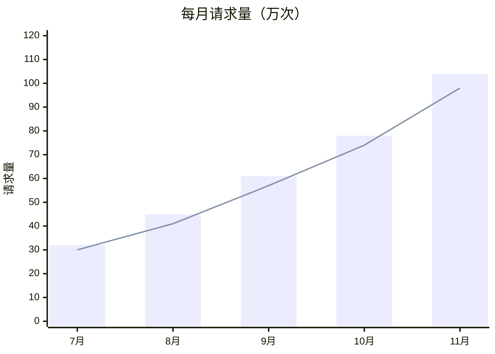
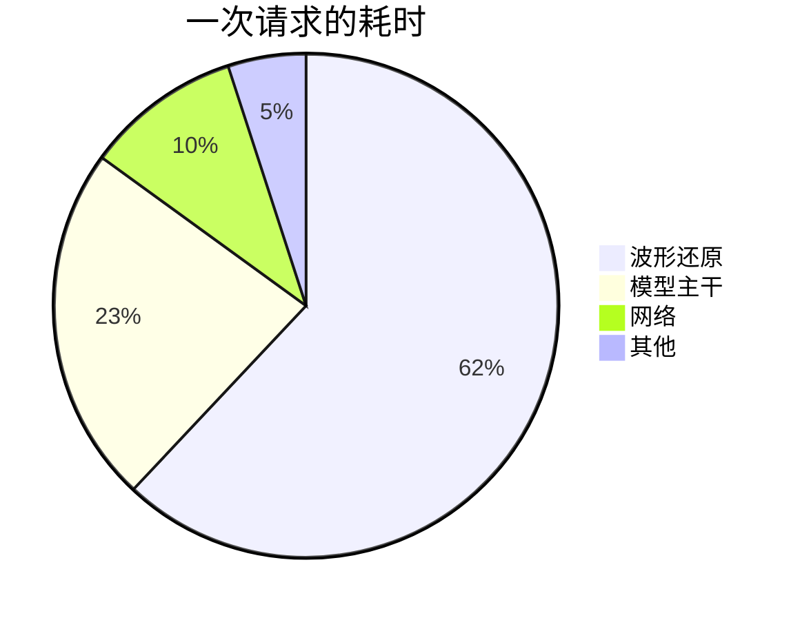
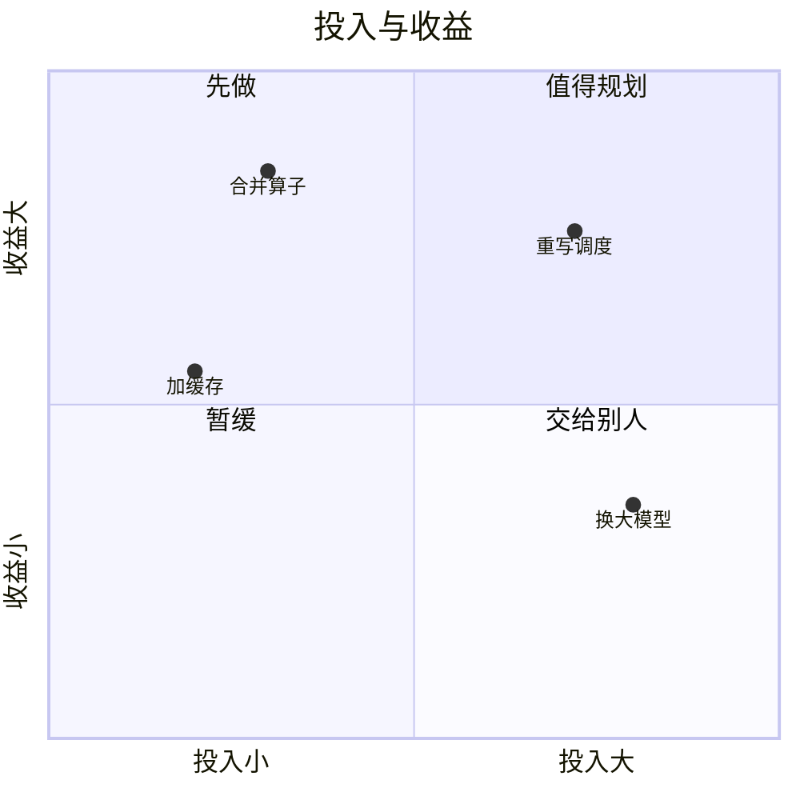
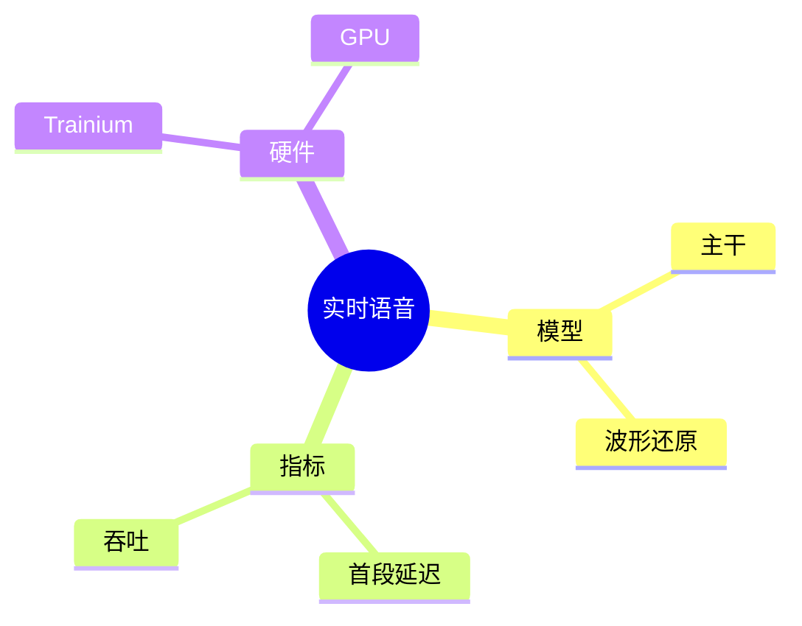
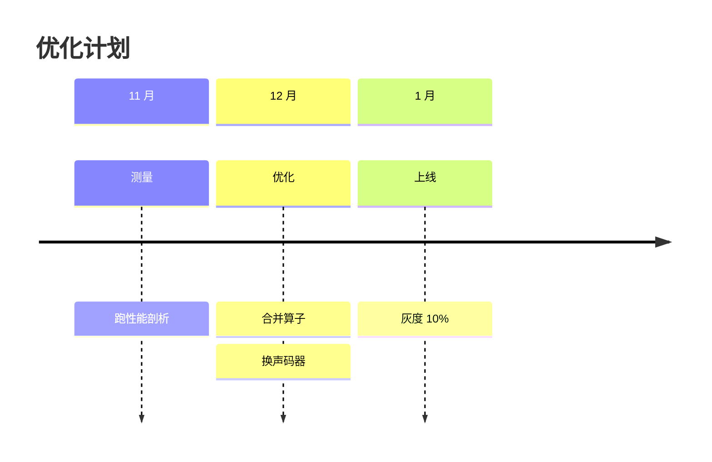
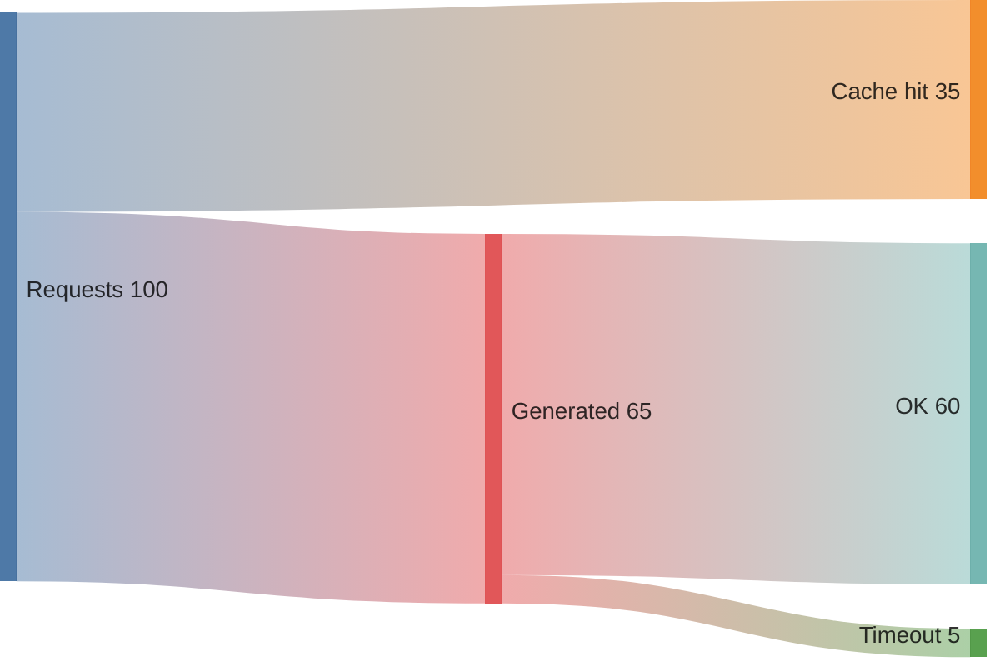

# 实时语音推理：一份速读

## 一句话结论

在 Trainium 上做实时语音，瓶颈不在模型主干，而在最后一步的波形还原；先量首段延迟，再谈吞吐。

## TTS 为什么慢

先说几个容易误标的词：SMS 和 TTSX 不是术语，`TTS` 在代码里不标，[TTS 文档](https://example.com/tts) 是链接也不标。

一个实时 TTS 系统先用 backbone 生成语音 token，再由 codec 把 token 还原成波形。VoxServe 的测量里，flow matching 占了 codec 九成以上的时间。用户最在意的是 TTFA：从发请求到听到第一声。第二次出现的 TTS 和 codec 不再加下划线。

## 图表

**每月请求量：柱状图加折线图**

**一次请求的耗时构成：饼图**

**先做哪件事：象限图**

**知识地图：思维导图**

**计划：时间线**

**流量去向：桑基图**（mermaid 的桑基图只认英文节点名）

## 怎么做

:::steps reveal 优化步骤
1. **测量**：在 Trn2 上跑性能剖析，记录每个模块的耗时。
2. **找瓶颈**：对比模型主干和波形还原的占比。
3. **改实现**：先合并转置卷积，再试更快的声码器。
4. **复测**：看首段延迟是否低于 200 ms。
:::

:::steps reveal
- [x] **11 月**：完成测量
- [ ] **12 月**：完成优化
- [ ] **1 月**：灰度上线
:::

## 术语表

- **TTS, Text-to-Speech（文本转语音）**：把文字变成声音。这里说的是实时 TTS，边说边出声。
- **backbone（骨干网络）**：语音模型里处理语义的主干部分。
- **codec（音频编解码器）**：把模型生成的语音 token 还原成波形的部分。
- **flow matching（流匹配）**：分多步"去噪"生成音频特征的方法，很耗算力。
- **TTFA, Time to First Audio（首段音频时间）**：从发请求到听到第一声的时间。
- **SM**：GPU 的计算单元。正文只在 SMS 里出现，所以不会被标出来。

## 要点回顾

- 实时语音的瓶颈在波形还原，不在模型主干。
- 先量首段延迟，再谈吞吐。
- 一次只改一处，每次都复测。
