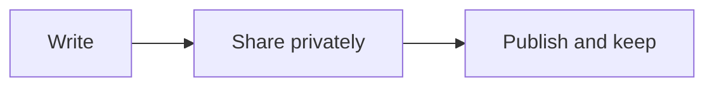

# Formatting guide

## TL;DR
Write ordinary Markdown and mdshare formats it for you. When you want more, a few extra blocks add callouts, number cards, comparisons, timelines and tabs. Everything here still reads fine as plain text, on GitHub, or anywhere else.

## Automatic formatting

You don't need any special syntax for these. They apply to every document, including ones published before this guide existed. A rule only fires when the pattern is clear; anything else renders as normal Markdown.

- **Contents and progress**: documents with three or more `##` sections get a contents sidebar, a reading-progress bar and an estimated reading time.
- **Summary card**: a first section called TL;DR, Summary, Bottom line, 结论 or 一句话结论 becomes a card at the top, like the one above.
- **Small headings**: a line that is only bold text, such as `**Key points**`, becomes a small heading and shows up in the contents.
- **Step cards**: a numbered list whose items all start in bold becomes a set of numbered cards.
- **Key points**: a bullet list written as `- **Label**: explanation` gets an accent rule, like this list.
- **Tables**: numeric columns are right-aligned, and cells that start with ✅, ❌ or ⚠️ are tinted.
- **Callouts**: a quote that starts with `Note:`, `Tip:`, `Warning:`, `注意：`, `提示：` or `警告：` becomes a callout box.
- **Code**: code blocks get a language label and a copy button.

**Step cards in action**

1. **Write** the document in Markdown, or let an agent do it.
2. **Share** it privately and check how it reads.
3. **Publish** when you're ready. Published documents are kept automatically.

## Callouts

GitHub-style alerts work, so they look right there too.

```markdown
> [!TIP]
> Publishing a document keeps it, so the link never expires by surprise.

> [!WARNING]
> Private documents expire after 24 hours unless you keep them.
```

> [!TIP]
> Publishing a document keeps it, so the link never expires by surprise.

> [!WARNING]
> Private documents expire after 24 hours unless you keep them.

The other types are `[!NOTE]`, `[!IMPORTANT]` and `[!CAUTION]`. You can also write a block with your own label:

```markdown
:::important Decision needed
Pick a launch date by Friday.
:::
```

:::important Decision needed
Pick a launch date by Friday.
:::

## Summary card

If your first section isn't named TL;DR or Summary, ask for the card explicitly. The text after the block name becomes the label.

```markdown
:::summary Bottom line
Ship the beta on Monday; hold the public launch until support is staffed.
:::
```

:::summary Bottom line
Ship the beta on Monday; hold the public launch until support is staffed.
:::

## Number cards

One card per line: `value | label`. Add `{up}`, `{down}` or `{accent}` at the end to color it. Numbers count up when they scroll into view.

```markdown
:::stats
$140.6M | first-half revenue
+1,252% | year over year {up}
25,000 | GPUs in use
3 | open risks {accent}
:::
```

:::stats
$140.6M | first-half revenue
+1,252% | year over year {up}
25,000 | GPUs in use
3 | open risks {accent}
:::

## Steps and timelines

A list inside `:::steps` becomes a timeline. Checked items (`[x]`) are shown as done.

```markdown
:::steps
- [x] **Cleanup**: new header, share panel, keep on publish
- [x] **Reading page**: typography, contents, automatic formatting
- [ ] **Accounts**: sign-up for other people
:::
```

:::steps
- [x] **Cleanup**: new header, share panel, keep on publish
- [x] **Reading page**: typography, contents, automatic formatting
- [ ] **Accounts**: sign-up for other people
:::

## Compare

Each `###` heading inside the block starts a column. The last column is highlighted.

```markdown
:::compare
### Before
- 13 controls in one row
- Expiry never shown
### After
- Share, Edit, Aa and ⋯
- Expiry in the status pill
:::
```

:::compare
### Before
- 13 controls in one row
- Expiry never shown
### After
- Share, Edit, Aa and ⋯
- Expiry in the status pill
:::

## Cards

Same idea as compare, for any number of equal cards.

```markdown
:::cards
### Private first
Links start private.
### Kept when shared
Publishing keeps a document.
### Agent native
Tokens with scopes.
:::
```

:::cards
### Private first
Links start private.
### Kept when shared
Publishing keeps a document.
### Agent native
Tokens with scopes.
:::

## Tabs

Each `###` heading becomes a tab.

````markdown
:::tabs
### curl
```bash
curl -X POST "$MDSHARE/api/share" -d '{"markdown":"# Hi"}'
```
### JavaScript
```js
await fetch('/api/share', { method: 'POST', body: JSON.stringify({ markdown: '# Hi' }) });
```
:::
````

:::tabs
### curl
```bash
curl -X POST "$MDSHARE/api/share" -d '{"markdown":"# Hi"}'
```
### JavaScript
```js
await fetch('/api/share', { method: 'POST', body: JSON.stringify({ markdown: '# Hi' }) });
```
:::

## Highlights and badges

```markdown
Launch is ==Dec 3==. Status: :badge[shipped] :badge[in progress] :badge[blocked] :badge[beta]{blue}
```

Launch is ==Dec 3==. Status: :badge[shipped] :badge[in progress] :badge[blocked] :badge[beta]{blue}

Badges pick a color from the words (shipped, done, 已上线 are green; blocked, risk are red; in progress, next are amber). Override with `{green}`, `{red}`, `{amber}`, `{blue}`, `{accent}` or `{gray}`.

## Page settings

An optional block at the very top sets the accent color, turns off the contents sidebar, or uses a wider page.

```markdown
---
accent: teal
toc: false
layout: wide
---
# My document
```

`accent` is one of `terracotta` (default), `amber`, `teal` or `indigo`. `toc` is `true` or `false`; `layout` is `standard` or `wide`. Unknown keys are ignored as plain text, so an ordinary document that starts with a horizontal rule is never affected.

## Tables, code and diagrams

| Feature | Plain Markdown | mdshare |
|---|---|---|
| Tables | ✅ yes | ✅ yes, tinted |
| Callouts | ⚠️ GitHub only | ✅ yes |
| Number cards | ❌ no | ✅ yes |
| Load time (ms) | 120 | 135 |



## For agents

Publish with `POST /api/share` and a JSON body `{"markdown": "...", "keep": true}`. Send `Authorization: Bearer <token>` to publish as yourself; `keep` is honoured for tokens and the owner. The plain-text version of this guide, written for models, is at [/llms.txt](/llms.txt).
