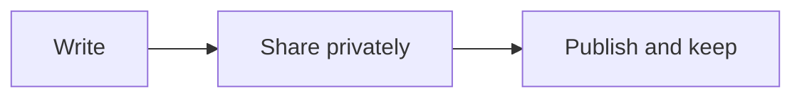
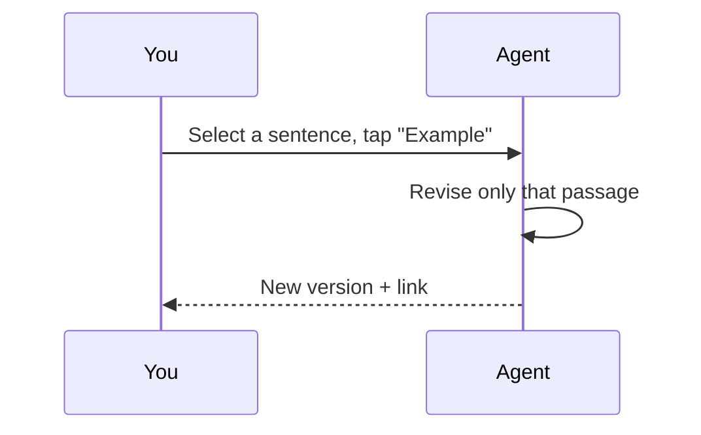
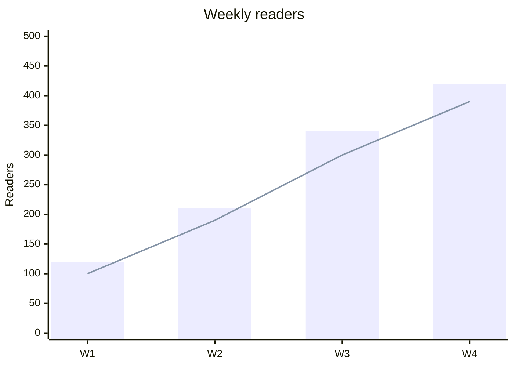
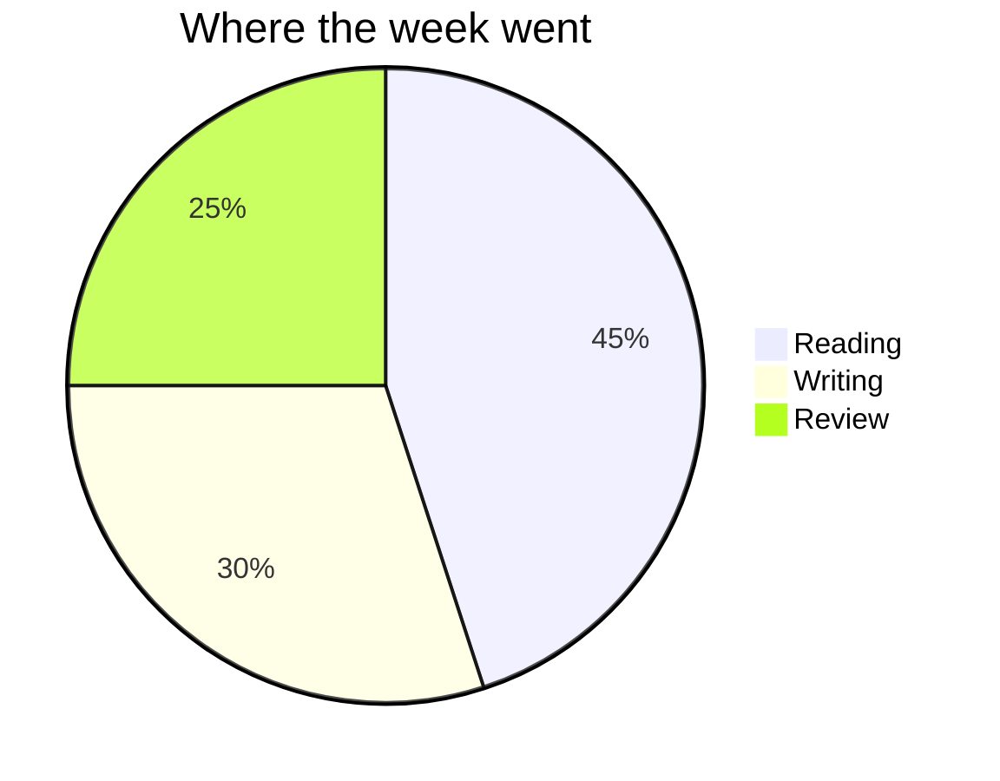
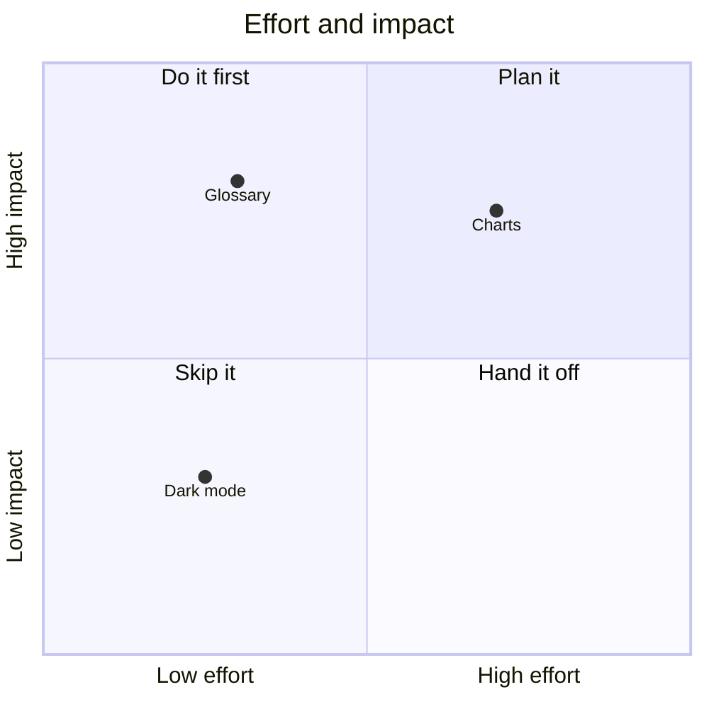
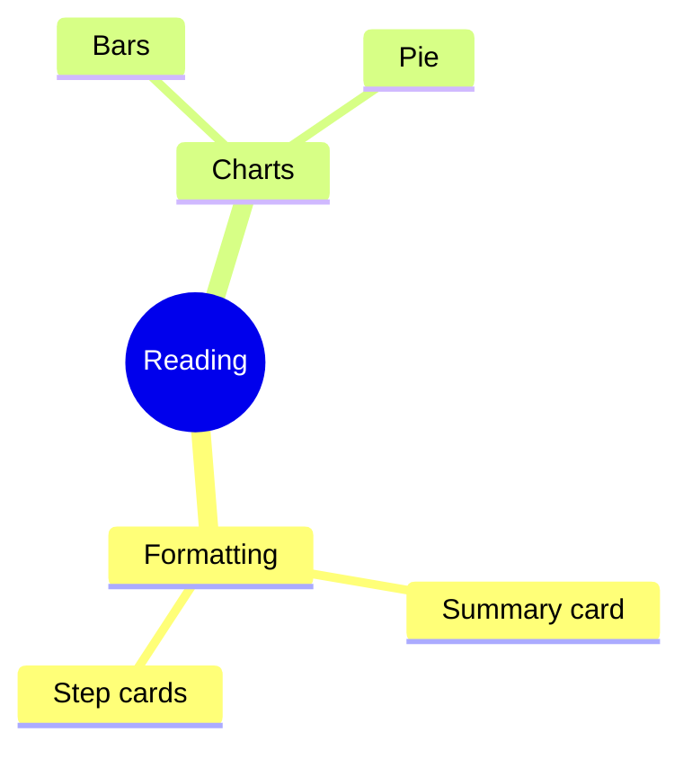
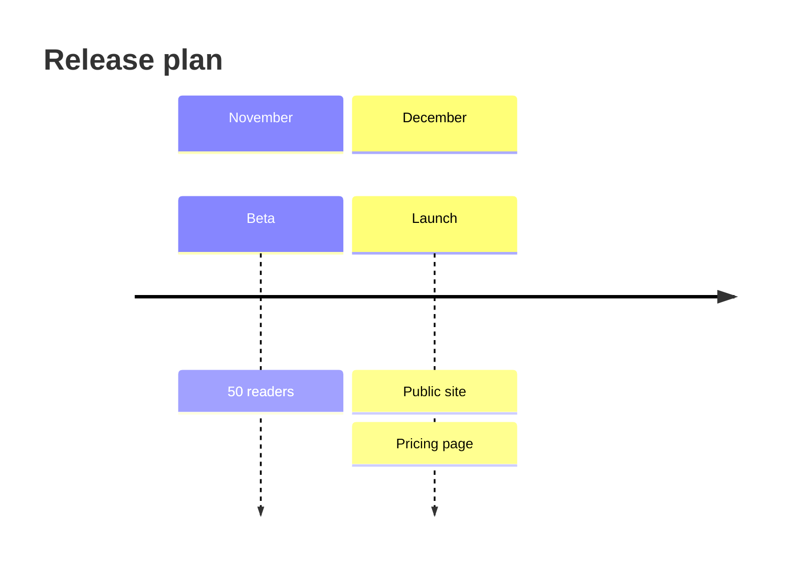

# Formatting guide

## TL;DR
Write ordinary Markdown and mdshare formats it for you. When you want more, a few extra blocks add callouts, number cards, comparisons, timelines and tabs. Everything here still reads fine as plain text, on GitHub, or anywhere else.

## Automatic formatting

You don't need any special syntax for these. They apply to every document, including ones published before this guide existed. A rule only fires when the pattern is clear; anything else renders as normal Markdown.

- **Contents and progress**: documents with three or more `##` sections get a contents sidebar, a reading-progress bar and an estimated reading time.
- **Summary card**: a first section called TL;DR, Summary, Bottom line, 结论 or 一句话结论 becomes a card at the top, like the one above.
- **Small headings**: a line that is only bold text, such as `**Key points**`, becomes a small heading and shows up in the contents.
- **Step cards**: a numbered list whose items all start in bold becomes a set of numbered cards.
- **Key points**: a bullet list written as `- **Label**: explanation` gets an accent rule, like this list.
- **Tables**: numeric columns are right-aligned, and cells that start with ✅, ❌ or ⚠️ are tinted.
- **Callouts**: a quote that starts with `Note:`, `Tip:`, `Warning:`, `注意：`, `提示：` or `警告：` becomes a callout box.
- **Code**: code blocks get a language label and a copy button.
- **Glossary**: a section called `## 术语表`, `## Glossary` or `## Terms` whose bullets are `- **Term**: definition` becomes a tidy card, and the first time each term appears in the text it gets a dotted underline that shows its definition. See [Glossary and recap](#glossary-and-recap).
- **Recap card**: a last section called `## 要点回顾`, `## Key takeaways` or `## Recap` becomes a card at the end, answering the summary card at the top.

**Step cards in action**

1. **Write** the document in Markdown, or let an agent do it.
2. **Share** it privately and check how it reads.
3. **Publish** when you're ready. Published documents are kept automatically.

## Callouts

GitHub-style alerts work, so they look right there too.

```markdown
> [!TIP]
> Publishing a document keeps it, so the link never expires by surprise.

> [!WARNING]
> Private documents expire after 24 hours unless you keep them.
```

> [!TIP]
> Publishing a document keeps it, so the link never expires by surprise.

> [!WARNING]
> Private documents expire after 24 hours unless you keep them.

The other types are `[!NOTE]`, `[!IMPORTANT]` and `[!CAUTION]`. You can also write a block with your own label:

```markdown
:::important Decision needed
Pick a launch date by Friday.
:::
```

:::important Decision needed
Pick a launch date by Friday.
:::

## Summary card

If your first section isn't named TL;DR or Summary, ask for the card explicitly. The text after the block name becomes the label.

```markdown
:::summary Bottom line
Ship the beta on Monday; hold the public launch until support is staffed.
:::
```

:::summary Bottom line
Ship the beta on Monday; hold the public launch until support is staffed.
:::

## Number cards

One card per line: `value | label`. Add `{up}`, `{down}` or `{accent}` at the end to color it. Numbers count up when they scroll into view.

```markdown
:::stats
$140.6M | first-half revenue
+1,252% | year over year {up}
25,000 | GPUs in use
3 | open risks {accent}
:::
```

:::stats
$140.6M | first-half revenue
+1,252% | year over year {up}
25,000 | GPUs in use
3 | open risks {accent}
:::

## Steps and timelines

A list inside `:::steps` becomes a timeline. Checked items (`[x]`) are shown as done.

```markdown
:::steps
- [x] **Cleanup**: new header, share panel, keep on publish
- [x] **Reading page**: typography, contents, automatic formatting
- [ ] **Accounts**: sign-up for other people
:::
```

:::steps
- [x] **Cleanup**: new header, share panel, keep on publish
- [x] **Reading page**: typography, contents, automatic formatting
- [ ] **Accounts**: sign-up for other people
:::

### One step at a time

Add `reveal` to walk a reader through steps: the first step shows with a **Next step** button and a **Show all** link (in Chinese documents 下一步 and 全部展开). A numbered list whose items start in bold shows as numbered cards; any other list as the timeline. Printing shows every step. Use it for a procedure the reader follows, not for a list they scan. Any words after `reveal` become the caption.

```markdown
:::steps reveal First deploy
1. **Install** the CLI with `npm i -g mdshare-cli`.
2. **Sign in** with the token from Settings.
3. **Publish** with `mdshare-cli create paste notes.md`.
:::
```

:::steps reveal First deploy
1. **Install** the CLI with `npm i -g mdshare-cli`.
2. **Sign in** with the token from Settings.
3. **Publish** with `mdshare-cli create paste notes.md`.
:::

## Compare

Each `###` heading inside the block starts a column. The last column is highlighted.

```markdown
:::compare
### Before
- 13 controls in one row
- Expiry never shown
### After
- Share, Edit, Aa and ⋯
- Expiry in the status pill
:::
```

:::compare
### Before
- 13 controls in one row
- Expiry never shown
### After
- Share, Edit, Aa and ⋯
- Expiry in the status pill
:::

## Cards

Same idea as compare, for any number of equal cards.

```markdown
:::cards
### Private first
Links start private.
### Kept when shared
Publishing keeps a document.
### Agent native
Tokens with scopes.
:::
```

:::cards
### Private first
Links start private.
### Kept when shared
Publishing keeps a document.
### Agent native
Tokens with scopes.
:::

## Tabs

Each `###` heading becomes a tab.

````markdown
:::tabs
### curl
```bash
curl -X POST "$MDSHARE/api/share" -d '{"markdown":"# Hi"}'
```
### JavaScript
```js
await fetch('/api/share', { method: 'POST', body: JSON.stringify({ markdown: '# Hi' }) });
```
:::
````

:::tabs
### curl
```bash
curl -X POST "$MDSHARE/api/share" -d '{"markdown":"# Hi"}'
```
### JavaScript
```js
await fetch('/api/share', { method: 'POST', body: JSON.stringify({ markdown: '# Hi' }) });
```
:::

## Highlights and badges

```markdown
Launch is ==Dec 3==. Status: :badge[shipped] :badge[in progress] :badge[blocked] :badge[beta]{blue}
```

Launch is ==Dec 3==. Status: :badge[shipped] :badge[in progress] :badge[blocked] :badge[beta]{blue}

Badges pick a color from the words (shipped, done, 已上线 are green; blocked, risk are red; in progress, next are amber). Override with `{green}`, `{red}`, `{amber}`, `{blue}`, `{accent}` or `{gray}`.

## Page settings

An optional block at the very top sets the accent color, turns off the contents sidebar, or uses a wider page.

```markdown
---
accent: teal
toc: false
layout: wide
---
# My document
```

`accent` is one of `terracotta` (default), `amber`, `teal` or `indigo`. `toc` is `true` or `false`; `layout` is `standard` or `wide`; `tables` is `auto` (default), `table`, `cards` or `compact`. Unknown keys are ignored as plain text, so an ordinary document that starts with a horizontal rule is never affected.

## Tables, code and diagrams

| Feature | Plain Markdown | mdshare |
|---|---|---|
| Tables | ✅ yes | ✅ yes, tinted |
| Callouts | ⚠️ GitHub only | ✅ yes |
| Number cards | ❌ no | ✅ yes |
| Load time (ms) | 120 | 135 |



Diagrams sit inside the document like a table: use one when a process, a flow between parts, an order of events or a plan is easier to see than to read. They take the page's colours (light and dark), scroll sideways inside their frame on a phone instead of shrinking to unreadable, and the **⤢** button opens a full-screen view. A diagram that can't be drawn shows its source with a note instead of an error picture.



Keep each diagram to one idea and about a dozen boxes, and keep labels short; put the explanation in the text around it. Labels with punctuation need quotes: `A["Score (0-1)"]`.

## Charts

Charts are mermaid blocks too. They are drawn in the page's colours (light, dark and paper) and at the width of the screen, so their labels stay readable on a phone; Chinese labels work. Pick the chart for the question the reader has:

- **Bar or line** (`xychart-beta`): how a number changes over time, or compares across a few groups. Quote the axis labels and start the y-axis at 0 for bars.
- **Pie**: how one whole splits into 2–6 parts. For more parts, or to compare them exactly, use bars.
- **Quadrant** (`quadrantChart`): a handful of options placed on two scales, such as effort and impact.
- **Mindmap**: a topic and its parts, two or three levels deep.
- **Timeline**: what happens when: dates or phases, each with one or two short events.

### Bar and line

````markdown

````


### Pie

````markdown

````


### Quadrant

````markdown

````


`quadrant-1` is the top right, then counter-clockwise: 2 top left, 3 bottom left, 4 bottom right. Coordinates go from 0 to 1.

### Mindmap

````markdown

````


Indentation makes the levels.

### Timeline

````markdown

````


A wide mindmap or timeline keeps its size on a phone and scrolls sideways inside its frame; **⤢** shows it full screen.

## Glossary and recap

Two sections are formatted by their title, so a document that explains new words or ends with a summary needs no extra syntax.

A **glossary** is a section titled exactly `术语`, `术语表`, `名词解释`, `关键术语`, `Glossary`, `Terms` or `Key terms`, holding a bullet list where every item is `- **Term**: definition` (or `：`). It renders as a card, and the first time each term appears in the text it gets a dotted underline: hover, tap or focus it to read the definition, with a link to the whole glossary. Names in one bold label are matched separately, so `**TTS, Text-to-Speech（文本转语音）**` underlines whichever of the three the text uses first.

A **recap** is the last `##` section, titled exactly `要点回顾`, `记住这几点`, `记住这三点`, `关键要点`, `Key takeaways`, `Takeaways`, `Recap` or `What to remember`. Two to four short bullets work best. It renders as a card that answers the summary at the top. A last section called Summary, Conclusion or 总结 stays an ordinary section.

```markdown
## Glossary

- **SLO**: service-level objective, the target the system must meet.
- **p99**: the latency 99% of requests stay under.

## Key takeaways

- Measure p99, not the mean.
- Change one thing at a time.
```

## Tables

Plain Markdown tables need nothing extra. The reader measures every table:
- short columns stay on one line, and no column gets squeezed below a readable width;
- a wide table grows into the free space beside the text;
- a very wide one scrolls inside itself, with the first column fixed.

On a phone, tables with a lot of text turn into cards.

Readers can switch any table between **Table** and **Cards**, open it full screen with **Expand**, or **Copy** it into a spreadsheet. Aa → Tables sets the default for every document.

To choose the view yourself, wrap one table in `:::table` with any of `cards`, `table`, `wide` or `compact`. Any other words become the table's caption:

```markdown
:::table cards 训练方式速查
| 方式 | 数据要求 | 成本 |
| --- | --- | --- |
| 微调 | 几百到几千条示范 | 中 |
:::
```

Or set it for the whole document with `tables: cards` (or `table`, `compact`, `auto`) in the page settings block.

## For agents

Publish with `POST /api/share` and a JSON body `{"markdown": "...", "keep": true}`. Send `Authorization: Bearer <token>` to publish as yourself; `keep` is honoured for tokens and the owner. The plain-text version of this guide, written for models, is at [/llms.txt](/llms.txt).

Agents read a document by fetching its `/v/<id>` link with `Authorization: Bearer <token>`: they get the Markdown instead of the page, under the same rules as `/raw/<id>`. Full-text search is `GET /api/doc?action=search&q=<text>` (titles and bodies, Chinese too) with a `documents:read` token; the Library search box uses the same search. When a request is refused, the answer says how to authenticate (send the token as `Authorization: Bearer`, not `x-api-key`). After you create a token in Settings, copy the agent block shown with it: it has this site's address, the token, and ready-made whoami, read, search and publish commands.

The create response includes `checks`: a list of problems the page will show (an unclosed code block or `:::` block, a table row with extra cells, a mermaid block that won't draw, a local file link). Fix them and publish again with `"parent": "<old id>"`; the old page then points readers to the new version, and the new one has **What changed**.

## Chinese and English versions, and collections

Publish the same text in both languages and link them: send `"lang": "zh"` and `"translation_of": "<id of the English page>"` (or `mdshare-cli create paste zh.md --translation-of <id>`). Both pages then get a small **中文 / English** switch above the title. A reader sees it only when the other page is public too, so a private translation is never revealed. You can link any two of your documents; an agent's token can only link documents that token published itself.

Group a series with `"collection": "glm-study"` (lowercase letters, digits and hyphens). Your collections are listed at [/c](/c), and each one at `/c/<slug>` is a table of contents only you can open: one row per document with its date, ⭐ Kept and whether you have read it. Older versions are hidden (each row links the newest version), and a Chinese/English pair is one row with both links. New versions and translations stay in the collection by themselves. In the Library, the collection chips above the list filter to one collection. To file an existing document, use `POST /api/doc?action=collection` or `mdshare-cli collection <id> <slug>`.

## Reading and feedback

When you (the owner) read a document, mdshare notes that you opened it and how far you got. Nobody else's reading is recorded.

Select any text in a document and a small bar appears: **Example**, **Unclear**, **Wrong**, **Expand** or **Note…** (in Chinese documents: 举个例子, 没看懂, 这里不对, 展开讲, 写一句…). Your feedback goes to the agent that wrote the document, with the passage you selected. The **Feedback** button at the bottom left lists what you sent and links each item to the version that fixed it.
